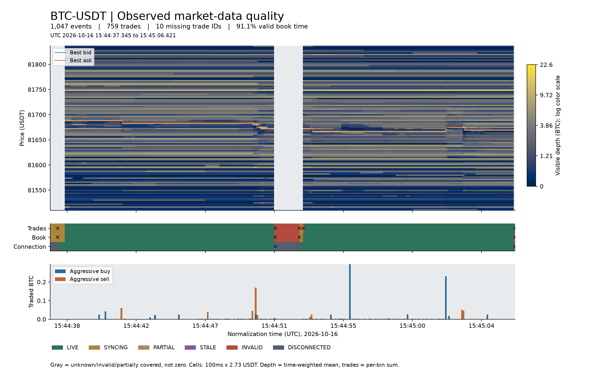

# Binance BTC 现货采集器

采集 BTCUSDT **100ms L2 增量、每侧最多5000档初始快照和原始逐笔成交**，提供持久日志、断点恢复、数据质量预览和历史回放。实时消费与回放共用 Event v1 和盘口计算内核。

Python 3.13 · macOS / Linux · 公开行情接口，免 API 密钥 · AGPL-3.0-or-later

## 快速启动

准备 uv 和 C 编译器，在项目目录执行：

```bash
uv sync --frozen --extra dev
uv run market-service run --config config/collector.toml
```

[配置文件](config/collector.toml)中的路径相对于 TOML 所在目录解析。默认日志 `data/btc.sqlite`、健康文件 `data/health.json`、发布 socket `/tmp/binance-btc-market.sock`。采集持续至 Ctrl+C / SIGTERM；加 `--seconds 60` 可录制60秒。

```bash
uv run market-service health --config config/collector.toml
```

心跳每5秒更新。连接、盘口和成交均 LIVE、输入新鲜且待处理帧为0时返回退出码0；同步或断线为 DEGRADED，心跳超时为 STALE。历史连续区间通过 `coverage` 查询。

## 数据质量热力图



样本时间：2026-10-16 15:44:37–15:45:06 UTC。**1047个事件、759笔观察成交、10个缺失成交 ID**；中央灰带为主动断线区间。

- 上图：可见挂单深度和最优买卖报价；颜色越亮，挂单量越大。
- 中图：连接、盘口、成交质量；× 标记同步、断线和缺段边界。
- 下图：观察到的主动买卖成交量。灰色表示未知，已知零量显示为最低色阶。

```bash
uv sync --frozen --extra preview
uv run market-service preview --db data/btc.sqlite --output data/quality-001.html --png data/quality-001.png --report data/quality-001.json
```

默认读取最后20000条事件，校验窗口事件链、盘口哈希和引用的原始输入。深度按持续时间加权，成交量按格求和。HTML 支持离线交互，PNG 可直接查看；输出使用新路径。参数和口径见[质量预览](docs/quality-preview.md)。

## 消费与回放

消费者分别保存游标与盘口检查点，重启后续读：

```bash
uv run market-service consume --socket /tmp/binance-btc-market.sock --state data/decision.sqlite
uv run market-service consume --socket /tmp/binance-btc-market.sock --state data/trading.sqlite
```

Publisher 从已提交日志追赶、追尾。采集进程退出后，重启服务和消费者即可恢复订阅。

```bash
uv run market-service verify --db data/btc.sqlite --report data/verification.json
uv run market-service replay --db data/btc.sqlite --report data/replay.json
```

`verify` 校验全部原始 checksum、事件链和盘口哈希。活动库先备份，再核验固定快照。回放顺序为 `market_seq`，保留原时间与质量状态。

历史也可通过相同 socket 接口发布：

```bash
uv run market-service serve --db data/btc.sqlite --socket /tmp/btc-history.sock
uv run market-service consume --socket /tmp/btc-history.sock --state data/history-consumer.sqlite --no-follow
```

## 网络与存储

|事件|处理|
|---|---|
|REST / WS 连接失败|带抖动退避重试，上限60秒；保留最近64条错误|
|HTTP 418 / 429|遵守 Retry-After；无有效值时等待120秒|
|盘口缺段、错误或过期|记录 INVALID，重连后获取快照并校验增量桥接|
|积压|按原始接收时间判断新鲜度|
|Ctrl+C / SIGTERM|处理已落盘尾部，记录 DISCONNECTED，释放写者锁|
|进程崩溃|恢复检查点和原始尾部，建立新连接与 epoch|
|磁盘低于预留量|保留日志，记录 DISK_LOW，以78退出|

SQLite WAL / FULL 持久化原始输入；每个输入对应的规范事件、去重索引、处理水位和检查点原子提交。写入失败后须重启恢复。

```bash
uv run market-service backup --db data/btc.sqlite --output data/backups/btc-001.sqlite
uv run market-service verify --db data/backups/btc-001.sqlite
```

备份使用 SQLite backup API，包含 WAL 提交，目标使用新文件。存储为单个追加日志；容量按实际增长率、备份需求和磁盘余量管理。自动分区、压缩归档及保留期清理待实现。

## 成交回补

```bash
uv run market-service repair --db data/btc.sqlite --catalog data/repairs.sqlite --follow
```

独立任务负责缺口发现、分页、去重和恢复；源不可用时保留缺口。官方日度 trades 支持离线导入，已完成112个缺失 ID 的回补验收。

`observed` 保存当时观察事实，`repaired` 加入事后补回事实。连接边界、盘口缺口和原始事件保持原样。详见[回补口径](docs/trade-repair.md)。

## 模块

```text
config.py / runtime.py   配置、生命周期、信号、健康、磁盘保护
network.py               aiohttp REST / WS、缓冲和重连
    ↓ RawFrame
service.py / binance.py  规范化、质量校验、Cryptofeed 快照与增量桥接
    ↓ Event v1
store.py                 SQLite 日志、事件链、去重、检查点
    ├─ ipc.py            日志追赶与实时追尾
    ├─ source.py         回放与消费游标
    ├─ backup.py         一致性备份
    └─ preview*.py       质量聚合、HTML / PNG
contracts.py / book.py   事件契约、orderbook C 扩展盘口计算
```

固定依赖及源码许可见 [THIRD_PARTY.md](THIRD_PARTY.md)。`vendor/` 保留82份上游源文件及校验清单，随项目构建。

## 验证与文档

```bash
make install
make check test
uv run python scripts/acceptance.py --db data/acceptance-new/live.sqlite --report data/acceptance-new/report.json --seconds 30
```

自动化测试覆盖本地网络故障、双消费者、进程中止恢复和备份。联网验收比较采集端、两消费者与历史回放的逐事件及盘口哈希，并强制重连和恢复消费游标。

[部署](docs/deployment.md) · [事件接口](docs/event-contract.md) · [采集验收](docs/collector-acceptance.md) · [L3研究](docs/l3-market-data.md)

原始行情、数据库、凭据和本机验收文件由 `.gitignore` 排除；README 静态图随仓库发布。文档中的 `evidence/` 为本地验收目录。
